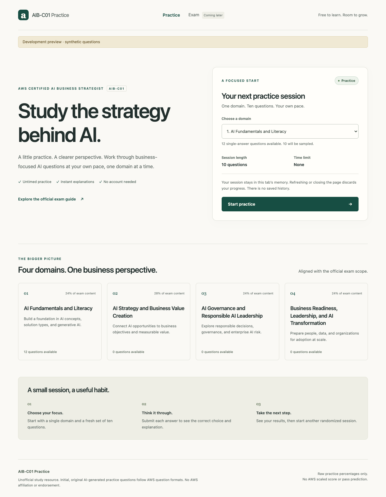
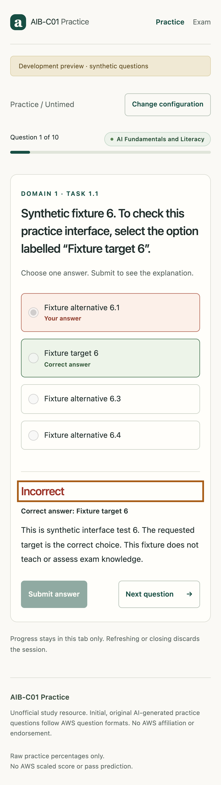

# Study AIB-C01

A free, unofficial study site for **AWS Certified AI Business Strategist (AIB-C01)**.
Initial, original AI-generated practice questions follow AWS question formats.
This project has no AWS affiliation or endorsement.

Practice offers untimed, ten-question sessions in one domain, with single-answer
and multiple-response questions. Select answers, submit for immediate feedback
and an explanation, finish with raw results, and start another randomized session. Questions do not
repeat within a session. Submitted answers are locked.

**Status:** local implementation; no live deployment yet. The public question
banks are currently empty, so production correctly disables Practice. Development
uses clearly labelled synthetic interface fixtures, which do not assess exam
knowledge and never become production question data. More session sizes and Exam
Mode are later slices.

## Screenshots

Development preview using labelled synthetic interface fixtures:





[View the results screen](docs/screenshots/development-results.png).
[View the single-column setup at 768px](docs/screenshots/development-wide-mobile-homepage.png).

## Local development

Use Node **22.23.4 or newer** and npm 10 or newer. `.nvmrc` pins a compatible
runtime; if you use nvm, run `nvm install` and `nvm use` first.

```sh
npm ci
npm run dev
```

Open the printed local URL (normally `http://localhost:4321`). Choose the first
domain, then **Start practice**. Development provides twelve synthetic questions
with both answer types, from which each session samples ten. Other domains
truthfully show no availability. Use Tab, arrow keys for radio options, and Space
to select answers, then submit. Next unlocks only after feedback. Results show total, attempted, correct, incorrect, unanswered, and
the raw percentage against the whole session.

Sessions live in tab memory. Refreshing or closing loses progress; supported
browsers warn before leaving an active session. Changing configuration asks before
discarding an active session. There are no accounts, saved history, or resume after
reload.

```sh
npm run check             # Astro diagnostics and strict TypeScript
npm test                 # Content and session public-interface tests
npm run test:e2e          # Chrome desktop, mobile viewport, built production
npm run build            # Validate public content, build static dist/
npm run preview          # Inspect the production build, not the fixture bank
```

Browser tests use installed Google Chrome. On a CI machine without Chrome, install
it first with `npx playwright install chrome`. Mobile tests emulate an iPhone-sized
viewport in Chromium; they do not replace testing Safari or an actual iOS device.
The end-to-end suite starts its own development, production, and static fixture
servers on ports 4321–4323. Set `PLAYWRIGHT_PORT` to change the first port (the
other two follow it), for example `PLAYWRIGHT_PORT=4341 npm run test:e2e`.
It also writes screenshots to the ignored `test-results/` directory.

An explicitly synthetic static build is available with `npm run build:fixtures`.
It writes to **`.qa-dist/`**, separate from production `dist/`, and includes a
development notice and `noindex` metadata. Run `npm run preview:fixtures` to inspect
it locally. Do not deploy `.qa-dist/` as production.

## Architecture

The interface uses an ink-on-white light theme with green/red answer feedback, self-hosted Inter and Plus
Jakarta Sans. The [visual guide](docs/design.md) records the design tokens and
component conventions. Styling uses native Astro/CSS with shadcn-inspired controls.

- `src/pages/index.astro`: meaningful static homepage HTML, metadata, domain
  information, and session configuration. Edit homepage copy in `src/content/site.ts`.
- `src/lib/exam-scope.ts`: shared official domain/task registry, in guide order.
- `src/lib/questions.ts`: canonical JSON Schema validation plus cross-record and
  content invariants; Practice eligibility and launch-count checks.
- `src/data/load-bank.ts`: build-time choice of public banks or development fixtures.
  Rendering and session rules do not load content themselves.
- `src/lib/session.ts`: DOM-free Practice rules, injected randomness/clock/storage,
  versioned session validation, and the in-memory storage adapter.
- `src/scripts/practice.ts`: browser events, focus, and leave warnings.
- `src/scripts/render-session.ts`: escaped HTML presentation of question, feedback,
  and summary state. Content is rendered as plain text, not interpreted HTML.

`PracticeSession.start(domainId, questions, dependencies)` creates a session.
`select`, `submit`, `next`, and `abandon` enforce its lifecycle. `record` returns a
defensive JSON-serializable copy; `result()` reports counts and percentage.
`PracticeSession.restore(record, dependencies)` validates a record before allowing
continuation. Invalid records fail rather than silently reset or repair themselves.

Version-1 records include the session ID, mode/configuration, ordered question
snapshots with SHA-256 content revisions, domain/task metadata, selections,
submission times, feedback, current index, lifecycle, and start/update/completion
timestamps. `deadlineAt` is reserved and must be `null` for untimed Practice. Exam
behavior is not implemented in this slice. The bank can change without changing
an existing session's snapshots or results.

`SessionStorage` exposes `save(record)` and `load(id)`. `MemorySessionStorage`
keeps independent copies of active, completed, and abandoned records for the tab's
lifetime. A future persistent adapter can use the same record and rules; this
release exposes no persistence or history UI.

## Public question contract

Store one version-1 JSON bank per domain in `src/data/questions/domain-N.json`:
an object with `schemaVersion: 1` and a `questions` array. The authoritative format
is [question-bank.schema.json](docs/agents/question-bank.schema.json).

Every question has `id`, `domainId`, `taskId`, `type`, `text`, stable `options`,
`correctOptionIds`, and `explanation`. `topic` and official public AWS `references`
are optional. Domain and task IDs must belong together. Single-answer records
have four options and one correct answer; multiple-response records have at least
five options and two correct answers. Both types are eligible for Practice.
Multiple-response checkboxes allow any nonempty set, including every option.
An empty submission is rejected; only the exact correct set earns credit, with
no partial credit. These answer-key cardinality rules do not limit selections.

Validation rejects extra fields, blank required text, wrong task/domain pairings,
mixed-domain files, duplicate question IDs across files, duplicate option IDs,
invalid answer membership/cardinality, and unsafe/non-AWS reference URLs. Smaller
valid pools are allowed; unsupported sessions are disabled instead of shortened.

```sh
npm run validate:content  # Structural and semantic validation; allows small pools
npm run validate:launch   # Also requires exactly 25 questions in each domain
```

The launch check intentionally fails until all four public banks reach 25
questions each. The production build uses only the public bank and does not
fall back to fixtures when content is missing. Answer keys are downloadable in
this static study tool by design.

## Build and deployment boundary

`npm run build` emits static files in `dist/`. `wrangler.json` serves that
directory with Cloudflare Workers Static Assets on a free `workers.dev` hostname.
`wrangler.preview.json` serves `.qa-dist/` through a separate preview Worker.
Neither configuration has a runtime handler, SSR adapter, data binding, custom
domain, or account requirement for students. Local build and preview commands
work without Cloudflare credentials.

Both builds run `validate:assets`. Its public allowlist permits only `index.html`,
`favicon.svg`, and generated JS, CSS, and WOFF2 files directly under `_astro/`.
Unexpected files, directories, symlinks, source maps, source JSON, and common
credential patterns fail validation. Production's embedded question payload must
match the public banks exactly and cannot contain fixture markers; the explicit
fixture target must match the synthetic bank and carry its visible notice and
`noindex` metadata. Credential-pattern checks supplement this allowlist; they are
not a general secret detector. Never put credentials in public assets or
`PUBLIC_` build variables.

```sh
npm run build
npm run preview                # Production output; no Cloudflare login
npm run build:fixtures
npm run preview:fixtures       # Explicitly synthetic output; no Cloudflare login
npm run deploy:dry-run         # Validate both Wrangler configs after both builds
```

The [deployment workflow](.github/workflows/deploy.yml) runs type checks, content
and session tests, browser journeys, both artifact checks, and Wrangler dry runs.
Pull requests run checks only. Pushes to `integration/spec-1` deploy the labelled
synthetic preview. Pushes to `main` deploy production only after the launch check
confirms 100 questions, 25 per domain. The workflow can also be dispatched with
`preview` selected; `production` requires the `main` branch. It reads the real
HTTPS URL from Wrangler's successful deployment output, downloads the page,
compares it with the built HTML, and records the verified URL in the run summary.

Account setup and first deployment:

1. Use a Cloudflare Free account and enable its `workers.dev` subdomain in the
   Workers dashboard. Select the intended account; no paid plan is needed.
2. Following [Cloudflare's GitHub Actions authentication instructions](https://developers.cloudflare.com/workers/ci-cd/external-cicd/github-actions/#1-authentication),
   create a Workers deployment API token scoped to that account. Store it and the
   account ID as GitHub Actions repository secrets named `CLOUDFLARE_API_TOKEN`
   and `CLOUDFLARE_ACCOUNT_ID`. Use GitHub Settings → Secrets and variables →
   Actions, or the interactive commands below. Enter secret values only into
   the secure prompt, never source files, issue comments, or chat.
3. Push the checked configuration to `integration/spec-1`. Open the repository's
   Actions page and wait for **Check and deploy static assets**. A missing secret
   produces a named error; configuring the workflow alone does not deploy a site.
4. Open the verified URL from the successful run summary. Confirm the synthetic
   notice, finish a Practice session without an account, and check the browser
   console and mobile layout. Record the actual run link, commit, and URL as
   deployment evidence. Add the live link here only after that verification.
5. Publish production from `main` once the initial question bank passes
   `npm run validate:launch`. Production never falls back to synthetic content.

```sh
gh secret set CLOUDFLARE_API_TOKEN --repo VennieSo/Study-AIB-C01
gh secret set CLOUDFLARE_ACCOUNT_ID --repo VennieSo/Study-AIB-C01
```

For a manual deployment after the same checks, use `npm run deploy:preview` or
`npm run deploy` with a local `wrangler login` session or securely supplied
Cloudflare environment variables. This does not demonstrate automatic GitHub
deployment. Do not create a second Cloudflare Builds integration alongside this
workflow: GitHub Actions is the deployment owner.

**Deployment status:** configuration and local verification are prepared; a
successful GitHub-triggered deployment and actual HTTPS URL are still pending
Cloudflare account authorization. Production is also pending the initial bank.
See [Cloudflare's static Astro configuration](https://developers.cloudflare.com/workers/framework-guides/web-apps/astro/#if-you-have-a-static-site)
and [Static Assets billing and limits](https://developers.cloudflare.com/workers/static-assets/billing-and-limitations/).

## Sources and limitations

The shared scope labels follow the [official AIB-C01 exam guide](https://docs.aws.amazon.com/aws-certification/latest/ai-business-strategist-01/ai-business-strategist-01.html).
The interface shows raw practice percentages, with equal question weight. It
offers no AWS scaled score, passing threshold, endorsement, or readiness prediction.
Multiple-response scoring requires an exact set match without limiting student
selection counts. Exam timers, review, and other presets remain future work.

The automated journeys cover Chrome desktop and a mobile viewport, keyboard
selection/focus, both feedback outcomes, answer locks, no repeats, reload warnings,
results/restart, production empty availability, and built homepage SEO. The session
tests cover JSON round-trip/continuation and malformed-record rejection.
