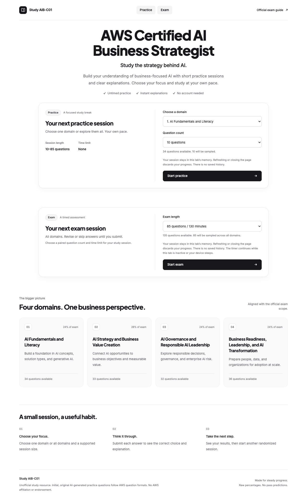

# Study AIB-C01

Free, unofficial practice for **AWS Certified AI Business Strategist (AIB-C01)**.
Study one domain or all four with **135 questions**, explanations, and no account.

**[Start studying](https://study-aib-c01.bigthink.workers.dev)** — free, no sign-up.

## Choose how to study

**Practice** is untimed. Choose one domain and 10, 15, 20, or 25 questions, or all
domains and 20, 40, 60, or 85 questions. Submit each answer for immediate feedback
and an explanation. Submitted answers are locked; finish to see your raw score
and results by domain.

**Exam** is timed and covers all domains. Choose a paired preset:

| Questions    | Time limit  |
| ------------ | ----------- |
| 20           | 30 minutes  |
| 40           | 65 minutes  |
| 60           | 95 minutes  |
| 85 (default) | 130 minutes |

Skip questions, move between them, and revise answers until you submit or time
runs out. Afterwards, review every question, your selections, the correct answers,
explanations, and available AWS references. Results include unanswered questions
and a breakdown by domain. The timer continues while the tab is inactive or your
device sleeps.

Both modes use single-answer and multiple-response questions, randomly selected
without repeats within a session. Multiple-response questions need the exact
correct set for credit; there is no partial credit. Start another session whenever
you want to practise again.

## Before you start

- **Progress lasts only in this tab.** Reloading or closing the page loses the
  session. There are no accounts, saved history, or resume after reload.
- **Scores are raw practice percentages.** Every question has equal weight and
  unanswered questions earn zero. Scores are not AWS scaled scores, passing
  thresholds, or predictions of exam readiness.
- **This is an unofficial study aid.** The questions are original AI-generated
  practice content, with no AWS affiliation or endorsement. Answer keys are
  downloadable as part of the site. Use the
  [official exam guide](https://docs.aws.amazon.com/aws-certification/latest/ai-business-strategist-01/ai-business-strategist-01.html)
  alongside your study.

## Screenshots

Study setup and results with the 135-question bank.

[Practice results](docs/screenshots/production-practice-results.png) ·
[Mobile Exam results](docs/screenshots/production-exam-results-mobile.png)

For contributors: [development and deployment guide](docs/development.md).
