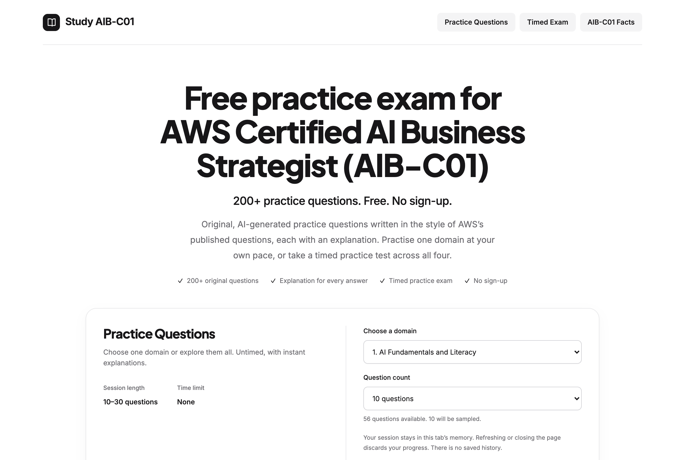

# Study AIB-C01

Free, unofficial practice for **AWS Certified AI Business Strategist (AIB-C01)**.
200+ original questions with explanations. No sign-up.

I made this site for my own exam preparation, because I wanted more questions
to practise on.

**[Start studying](https://aib-c01.vennie.so)**

## Two ways to study

**Practice Questions** are untimed. Pick one domain or all four, answer 10 to 30
questions, and see the correct answer and an explanation after each one.

**Timed Exam** covers all four domains under a time limit, from a 40-minute
session up to full exam length. Skip, go back and change answers until you
submit, then review every question with its explanation.

## Good to know

- **Progress lasts only in the tab.** Reloading or closing the page ends the
  session. There are no accounts and no saved history.
- **Scores are raw percentages.** They are not AWS scaled scores and do not
  predict whether you will pass.
- **The questions are AI-generated and unofficial.** They are not real exam
  questions, and AWS has not reviewed or endorsed them. Study the
  [official exam guide](https://docs.aws.amazon.com/aws-certification/latest/ai-business-strategist-01/ai-business-strategist-01.html)
  alongside them.
- **Some questions may be wrong.** If you find an error, please
  [open an issue](https://github.com/VennieSo/Study-AIB-C01/issues).

## How this was built

I built this site by working with AI coding agents. I wrote the brief, made the
product and architecture decisions, and reviewed the result; the agents wrote
the code. The [project notes](docs/development.md) explain the decisions.

AI automated almost all of the build. The question bank was the hard part. It
took about two days of repeated rounds, and I threw away whole batches. Early
questions felt mechanical, gave away the answer in their wording, or drifted
from the official exam guide. It was important to me that they read like
high-quality practice questions, follow AWS's own exam guide, have one
defensible answer, and test real business reasoning.

## Use and credits

The site is free to use, for personal use only. Please do not republish the
questions or claim them as your own.

- Domain, task and skill statements are from the
  [AWS exam guide](https://docs.aws.amazon.com/aws-certification/latest/ai-business-strategist-01/ai-business-strategist-01.html),
  © Amazon Web Services, used under
  [CC BY-SA 4.0](https://creativecommons.org/licenses/by-sa/4.0/). Some are
  shortened.
- Thanks to [Matthew Purcell](https://www.linkedin.com/in/purcellmatthew), who
  shared his own practice question set, updated after he sat and passed the
  exam, under [CC BY-NC 4.0](https://creativecommons.org/licenses/by-nc/4.0/).
  I found his
  questions to be of high quality. Matthew said most of the exam is made up of
  longer questions like those in his set, so I added questions of similar
  length to this site, hoping to create an experience closer to exam day. I
  had not taken the exam when I built this bank, so I will only be able to
  tell later which style is closer.
- AWS and related marks are trademarks of Amazon.com, Inc. or its affiliates.
  This project is not affiliated with or endorsed by AWS.

If you believe anything here should not be here, please
[open an issue](https://github.com/VennieSo/Study-AIB-C01/issues).

Built by [Vennie So](https://www.linkedin.com/in/vennieso/).
