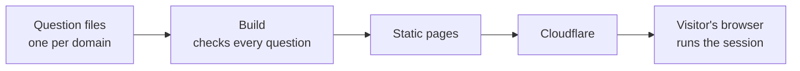

# How this project works

Notes on how [Study AIB-C01](../README.md) is put together and why. I built it
with AI coding agents: the decisions below are mine, the code is theirs.

## Run it

Needs Node 24 (`nvm use` picks the right version).

```sh
npm ci            # install
npm run dev       # local site with placeholder questions
npm run check     # type check
npm test          # unit tests
npm run test:e2e  # browser tests
npm run build     # production build with the real question bank
npm run preview   # view the production build locally
```

Pushing to `main` runs every check, then deploys to
[aib-c01.vennie.so](https://aib-c01.vennie.so).

## Deploy notes

- GitHub Actions deploys production on every push to `main`. The preview site
  deploys only when run by hand from the Actions tab.
- The Cloudflare token is stored as a GitHub secret. The least privilege it
  needs is edit access to the two Workers. If a custom domain is used, it also
  needs Workers Routes edit and Zone read for that domain.
- After each deploy, the pipeline runs the browser tests against the live site
  and compares every public file with the build.

## How it fits together



- There is no server and no database. The build turns the question files and
  page templates into plain files, and Cloudflare serves them.
- The build refuses to finish if a question breaks the format, for example a
  wrong number of options or an answer that is not among them.
- Everything that happens in a session (picking questions, timing, scoring)
  runs in the visitor's browser.

## Decisions

### A static site, with the answers exposed

This project started with the idea of making something quickly. That took the 
very first design decision toward a static site. It means the whole question 
bank is sent to the browser, answer keys included. A backend would hide them, 
but it adds complexity, running costs, accounts and something to secure. 
Since this is a study aid I am sharing freely, I accepted the exposure.

### Cloudflare over GitHub Pages

Both host static files for free. GitHub Pages is the simpler setup, but it has
a soft bandwidth limit of 100 GB a month. Cloudflare has no request limit on
static files, which leaves room if the site gets popular, and the repository
can still be public. The cost is one more account and an access token to look
after. I limited that token to this project, and GitHub Actions is the only
thing that deploys, so there is one pipeline to reason about.

### Astro over plain TypeScript or React

The site is mostly content: a homepage, an exam facts page, and one
interactive part, the study session. Plain TypeScript would mean hand-building
every page and its metadata. React would ship a framework to the browser to
render pages that never change. Astro builds the pages as plain HTML, which is
also what search engines read best, and sends script only for the session. It
is the easier of the three to maintain and add pages to.

### Progress is not saved, but it could be

A session lives in the browser tab and is lost on reload. Saving progress was
not needed for launch, and skipping it meant no personal data to handle. I did
not want adding it later to mean a rewrite, so I asked for session state to be
a plain, versioned record behind a small storage interface. Saving sessions to
the browser later means writing one new storage adapter, not changing the
session rules.

### Placeholder questions first, and a separate preview site

Writing good questions was the real work, and I did not want the site waiting
on it. So every feature was built and tested against clearly labelled
placeholder questions, which proved the product worked in a fast overnight
build.
Those placeholders are deployed to a separate preview site that search engines
are told to ignore. The production build only accepts the real bank and fails
if it is missing; it never falls back to placeholders.

### Question bank coverage can be checked against the exam guide

Besides its text, options, answer key and explanation, each question is tagged
with a `domainId`, `taskId` and `skillId` from the exam guide. The tags let the
bank be checked against the guide, to confirm that every task and skill is
covered and has enough variety. The launch gate was a minimum of 25 questions
per domain (100 in total), and the bank can keep growing.

### Google Analytics over Cloudflare analytics

Cloudflare's built-in analytics needs no cookies and no consent banner, which
makes it the simpler choice. It is also bare: page views and little else. I
come from marketing and know Google Analytics well, so that's what I default to. But choosing GA4 means cookies, and asking for consent. I used a small open-source library,
[orestbida/cookieconsent](https://github.com/orestbida/cookieconsent), over
building a banner or paying for a consent platform. Analytics load only after
a visitor accepts, and the preview site has none.

## Limits

- Automated tests run in Chrome on desktop and at phone width only.
- No saved progress, by design for now.
- Answer keys are downloadable, by design.
